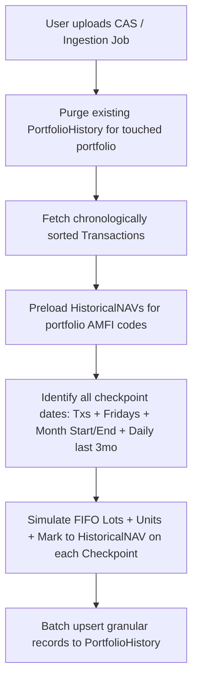

# Implementation Plan: Granular Historical Valuation Timeline Reconstruction

## Overview
Currently, `portfolio-worker`'s `history_refresh.rs` updates folio NAVs and computes portfolio valuation checkpoints **solely on dates when a transaction occurs** (with a single mark-to-market snap for "today"). When an asset has multi-year gaps between transactions (such as UTI Nifty 50 Index Fund between Feb 2023 and Nov 2024), its valuation stays frozen at the old transaction NAV, producing an artificial cliff when a new transaction finally takes place.

This feature introduces **granular historical valuation checkpoints**:
- **Rule for checkpoints**:
  - For dates older than 3 months from today: include **every Friday**, **first day of the month**, **last day of the month**, and **all transaction dates**.
  - For dates within the last 3 months: include **every single day**.
  - Mandatorily include the **first day and last day of every month**, regardless of age.
- **Mark-to-Market Valuation**:
  - On each checkpoint date, value active holdings using the published `HistoricalNAV` (with fallback to previous known NAV or transaction NAV).
- **Auto-Reconstruction on CAS Update**:
  - CAS uploads (`cas_parser.rs`) already call `purge_portfolio_history` followed by `process_history_refresh_job_with_pool`. Updating `history_refresh.rs` automatically ensures any new CAS upload or re-ingest reconstructs the full granular timeline immediately.
  - In addition, an executable backfill CLI / script will re-process existing portfolios in the database.

---

## Architecture & Data Flow



---

## Detailed Task Breakdown

### Task 1: Checkpoint Policy Predicate & Unit Tests in `portfolio-core` / `portfolio-worker`
- **Location**: `backend-rs/crates/portfolio-worker/src/jobs/history_refresh.rs` (or helper module `timeline.rs`).
- **Function**: `is_checkpoint_date(date: NaiveDate, today: NaiveDate, has_transaction: bool) -> bool`
  - If `has_transaction`: returns `true`.
  - If `date == first_day_of_month(date)` or `date == last_day_of_month(date)`: returns `true`.
  - If `date >= today - 90 days`: returns `true` (every day in last 3 months).
  - If `date.weekday() == Weekday::Fri`: returns `true` (every Friday older than 3 months).
  - Otherwise: returns `false`.
- **Tests**:
  - Unit tests verifying Fridays, month starts, month ends, within-90-days daily, and skipping non-Friday weekdays older than 90 days.
  - Property-based tests (`proptests.rs`) validating invariant: every transaction date, month start, and month end is strictly a checkpoint date.

### Task 2: Repository Method for Historical NAV Series in `portfolio-db`
- **Location**: `backend-rs/crates/portfolio-db/src/repositories/cas_ingest_repo.rs` & `test_mocks.rs`.
- **Method**: `fetch_historical_navs_for_portfolio(pool: &PgPool, portfolio_id: Uuid) -> Result<HashMap<String, BTreeMap<NaiveDate, Decimal>>, DbError>`
  - Fetches all historical NAVs for schemes associated with the portfolio's folios:
    ```sql
    SELECT a."amfiCode", h.date::date as dt, h.nav::numeric
    FROM "Folio" f
    JOIN "Asset" a ON a.id = f."assetId"
    JOIN "HistoricalNAV" h ON h."amfiCode" = a."amfiCode"
    WHERE f."portfolioId" = $1 AND h.nav > 0
    ORDER BY a."amfiCode", dt ASC;
    ```
  - In `InMemoryDatabase`: provide matching mock method looking up `db.list_navs(amfi)`.

### Task 3: Timeline Replay Engine in `portfolio-worker`
- **Location**: `backend-rs/crates/portfolio-worker/src/jobs/history_refresh.rs`.
- **Logic**:
  1. Determine `start_date` = first transaction date, `end_date` = `today`.
  2. Index transactions by `NaiveDate`.
  3. Preload historical NAVs by AMFI code (with binary search / BTreeMap range lookup for closest $\le$ checkpoint date).
  4. Iterate date by date from `start_date` to `end_date`:
     - Apply any transactions on `date` to update `folio_state.active_units`, `fifo_lots`, and `invested_cost`.
     - Check if `date` is a checkpoint date (`is_checkpoint_date(...)`).
     - If yes, resolve each active folio's NAV from `HistoricalNAV` (as of $\le$ `date`), falling back to `folio_state.latest_nav`.
     - Record valuation checkpoint `(date, total_value, total_invested_cost)`.
  5. Bulk upsert all checkpoints into `PortfolioHistory`.

### Task 4: Automated Trigger on CAS Ingestion & Dedicated Backfill CLI
- Verify that `cas_parser.rs` Step 6 already calls `process_history_refresh_job_with_pool` for all touched portfolios.
- Ensure `backend-rs/crates/portfolio-worker/src/bin/refresh_history.rs` re-processes any portfolio passed via CLI or all portfolios.
- Run backfill on container to refresh target user portfolios and other portfolios.

### Task 5: Comprehensive Testing
- **Unit & Contract Tests**:
  - Test with mock portfolio having a 2-year purchase gap: assert smooth progression without sudden jump cliffs.
  - Test month boundaries (Feb 28/29, Mar 31, etc.) and Friday selections.
- **Property-Based Invariant Tests (`proptests.rs`)**:
  - Precision bounds: value and cost are non-negative, unit allocations are non-negative.
  - Checkpoint completeness: month start/end and transaction dates are always present in the history series.
- **Parity & Hermetic Verification**:
  - Pass `cargo check`, `cargo clippy`, `cargo test`, `cargo fmt`.
  - Pass `cargo run --package portfolio-parity`.
  - Pass `pnpm --filter frontend test:unit` & build.
- **E2E / Integration Verification**:
  - Verify historical valuation curve via Playwright / API contract on the local Docker environment.
