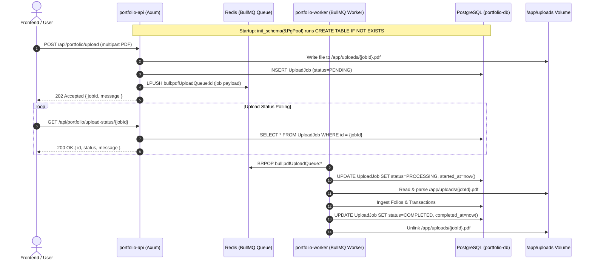

# Design Specification: Rust Backend Cutover & Docker E2E Verification

**Date:** 2026-10-18  
**Topic:** Rust Backend Cutover and End-to-End Docker Setup Verification  
**Status:** Approved  
**Branch:** `feat/rust-backend-migration`

---

## 1. Executive Summary

This specification establishes the final cutover from the legacy Node.js/Express/Prisma backend to the high-performance Rust backend (`backend-rs`) across the entire repository. It removes the legacy TypeScript backend and worker services from `docker-compose.yml`, introduces self-healing PostgreSQL schema initialization in `portfolio-db`, expands Axum REST endpoints in `portfolio-api` to achieve full wire parity (including multipart file uploads, upload status polling, portfolio overview, and analytics endpoints), connects `portfolio-worker` to live BullMQ Redis queues, and validates the deployment with Playwright E2E tests against running Docker containers.

---

## 2. Goals & Success Criteria

1. **Complete Cutover:**
   - In `docker-compose.yml`, `backend` and `worker` build and execute exclusively from `./backend-rs/Dockerfile`.
   - Legacy TypeScript backend and worker definitions are completely removed from `docker-compose.yml`.
2. **Self-Healing Schema Persistence (`portfolio-db`):**
   - No external dependency on `npx prisma migrate deploy` in production containers.
   - Idempotent schema initialization (`init_schema(&PgPool)`) executes on startup if tables or indexes are missing.
   - Dual-mode `AppState`: seamlessly switches between live PostgreSQL pools and hermetic `InMemoryDatabase`.
3. **Full REST API Wire Parity (`portfolio-api`):**
   - Multipart file upload: `POST /api/portfolio/upload` streams incoming CAS statements to `/app/uploads/{jobId}.pdf`, registers an `UploadJob` record in PostgreSQL, and enqueues to BullMQ `pdfUploadQueue`.
   - Upload polling: `GET /api/portfolio/upload-status/:jobId` returns typed status (`PENDING`, `PROCESSING`, `COMPLETED`, `FAILED`).
   - Summary & Analytics: `GET /api/portfolio/summary`, `GET /api/portfolio/:id/xray`, `GET /api/portfolio/:id/exposures`, `GET /api/portfolio/:id/tax-summary`, `GET /api/portfolio/:id/history`, and `GET /api/portfolio/:id/stats`.
   - Folio lifecycle: `POST /api/portfolio/folio/:folioId/close`, `DELETE /api/portfolio/folio/:folioId`, `DELETE /api/portfolio/purge`, `POST /api/portfolio/manual-asset`.
   - Health & Insights: `GET /api/health/:portfolioId/insights` and `GET /api/health/:portfolioId/goals`.
4. **Live Background Worker (`portfolio-worker`):**
   - Connects to BullMQ Redis (`bull:pdfUploadQueue:*`) and PostgreSQL in production mode.
   - Transitions `UploadJob` status: `PENDING` $\to$ `PROCESSING` $\to$ `COMPLETED` / `FAILED`.
   - Unconditionally unlinks temporary upload files upon completion or failure.
5. **Hermetic & E2E Verification:**
   - All 83+ unit and property tests in `cargo test --workspace` pass.
   - Numerical parity certification (`cargo run -p portfolio-parity`) passes 100%.
   - Full Docker compose stack (`postgres`, `redis`, `backend`, `worker`, `frontend`) starts and reaches healthy status.
   - Playwright Docker E2E test suite passes against the live containerized stack (`npm run test:e2e:docker`).

---

## 3. Architecture & Data Flow

---

## 4. Detailed Component Design

### 4.1 Persistence Layer (`portfolio-db`)
- **Schema Initializer:**
  `portfolio_db::init_schema(pool: &PgPool) -> Result<(), sqlx::Error>` creates all tables, primary keys, foreign keys, unique constraints, and indexes idempotently:
  - `"User"`
  - `"ManagedProfile"`
  - `"FamilyGroup"` & `"FamilyMember"`
  - `"Portfolio"`
  - `"Asset"` (including `exitLoadMetadata`)
  - `"Folio"`
  - `"Transaction"`
  - `"UploadJob"`
  - `"PortfolioHistory"`
  - `"HistoricalNAV"`
  - `"Goal"`
- **Backend Abstraction:**
  `DbBackend` enum in `portfolio-api::state::AppState`:
  - `DbBackend::Postgres(Arc<PgPool>)` for production runtime.
  - `DbBackend::InMemory(Arc<InMemoryDatabase>)` for hermetic contract testing without Docker or external daemons.

### 4.2 REST Gateway (`portfolio-api`)
- **Multipart Upload Handler:**
  - Route: `POST /api/portfolio/upload`
  - Uses `axum::extract::Multipart` with a 50MB size limit.
  - Generates a UUID `jobId` and streams bytes to `/app/uploads/{jobId}.pdf`.
  - Creates database entity `UploadJobEntity` with status `PENDING`.
  - Enqueues job to Redis list `bull:pdfUploadQueue:id`.
  - Returns `202 Accepted` with `{ "jobId": jobId, "message": "PDF upload accepted and processing has started." }`.
- **Upload Status Handler:**
  - Route: `GET /api/portfolio/upload-status/:jobId`
  - Queries `UploadJob` by `jobId`. Validates `job.user_id == auth_user.user_id`.
  - Returns `{ "id": jobId, "status": "PENDING" | "PROCESSING" | "COMPLETED" | "FAILED", "message": String, "createdAt": ..., "updatedAt": ..., "startedAt": ..., "completedAt": ... }`.
- **Portfolio Summary Handler:**
  - Route: `GET /api/portfolio/summary` (supports `?profileId=...` and `?taxSlab=...`)
  - Loads folios and transactions for the specified user and profile.
  - Computes active vs closed folios, invested amounts, current values, day change, total gains, absolute returns, and XIRR via `portfolio-core`.
  - Returns camelCase JSON matching existing frontend expectations.
- **Analytics, Lifecycle, and Health Endpoints:**
  - `GET /api/portfolio/:id/xray` (asset allocation & market cap breakdown)
  - `GET /api/portfolio/:id/exposures` (underlying company exposure list)
  - `GET /api/portfolio/:id/tax-summary` (realized & unrealized gains summary)
  - `GET /api/portfolio/:id/history` (timeline data points)
  - `GET /api/portfolio/:id/stats` (all-time high & max invested stats)
  - `POST /api/portfolio/folio/:folioId/close` (manual folio close redemption)
  - `DELETE /api/portfolio/folio/:folioId` (single folio deletion)
  - `DELETE /api/portfolio/purge` (cascading user data reset)
  - `POST /api/portfolio/manual-asset` & `DELETE /api/portfolio/manual-asset/:folioId`
  - `GET /api/health/:portfolioId/insights` & `GET /api/health/:portfolioId/goals`

### 4.3 Background Worker (`portfolio-worker`)
- Production binary `src/main.rs` initializes connection to Redis and PostgreSQL.
- Dequeues `ProcessPdfUploadJobData` from `bull:pdfUploadQueue:*`.
- Marks job `PROCESSING` in PostgreSQL.
- Executes `casparser` (Python CLI) on `/app/uploads/{jobId}.pdf` or parses synthetic JSON.
- Creates/updates assets, folios, and transactions.
- Refreshes historical snapshots via `process_history_refresh_job`.
- Marks job `COMPLETED` and unconditionally deletes the uploaded temporary file.
- On parsing errors, marks job `FAILED` with the error description and safely unlinks the file.

### 4.4 Docker Orchestration (`docker-compose.yml`)
- Service `backend`:
  - Build context: `./backend-rs`
  - Dockerfile: `Dockerfile`
  - Command: Default (`["portfolio-api"]`)
  - Ports: `3001:3001`
  - Environment: `DATABASE_URL`, `REDIS_HOST`, `REDIS_PORT`, `PORT=3001`, `JWT_SECRET`, `PYTHON_PATH=python3`, `TZ`.
  - Volumes: `shared_uploads:/app/uploads`
- Service `worker`:
  - Build context: `./backend-rs`
  - Dockerfile: `Dockerfile`
  - Command: `["portfolio-worker"]`
  - Environment: `DATABASE_URL`, `REDIS_HOST`, `REDIS_PORT`, `PYTHON_PATH=python3`, `TZ`.
  - Volumes: `shared_uploads:/app/uploads`
- Service `frontend`:
  - Depends on `backend`.
  - Connects to `http://${IP_GLOBAL}:${VITE_API_PORT}`.
- Removed:
  - All Node.js backend build contexts and Dockerfiles from `docker-compose.yml`.
  - Removed `profiles: ["rust"]` so Rust runs out-of-the-box on `docker compose up`.

---

## 5. Testing & Validation Strategy

1. **Unit & Property Tests:**
   - Execute `cargo test --workspace` across all 5 crates.
   - Run `cargo clippy --workspace --all-targets -- -D warnings` and `cargo fmt --check`.
2. **Parity Validation:**
   - Execute `cargo run --package portfolio-parity` to confirm 100% precision compliance.
3. **Live Container Build & Startup:**
   - Run `docker compose build`.
   - Run `docker compose up -d`.
   - Poll until PostgreSQL, Redis, Rust Backend, Rust Worker, and Frontend are healthy and responding to HTTP `GET http://localhost:3001/api/health` and `GET http://localhost:8082`.
4. **Playwright E2E Test Execution:**
   - Run `npm run test:e2e:docker` in `frontend/`.
   - Verify `tests/smoke.spec.ts` (page load, logo, empty state).
   - Verify `tests/mock-portfolios.spec.ts` (10 synthetic scenarios in UI).
   - Verify `tests/e2e-integration.spec.ts` (real PDF upload handoff from Rust backend to Rust worker).
5. **Teardown:**
   - Run `docker compose down -v` to ensure clean resource release.
